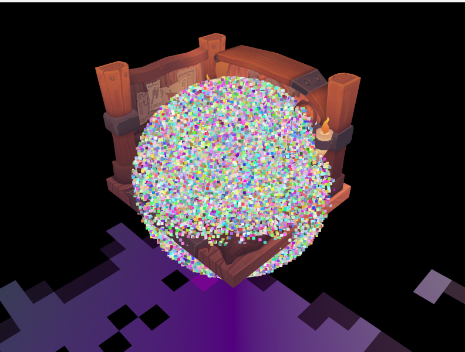
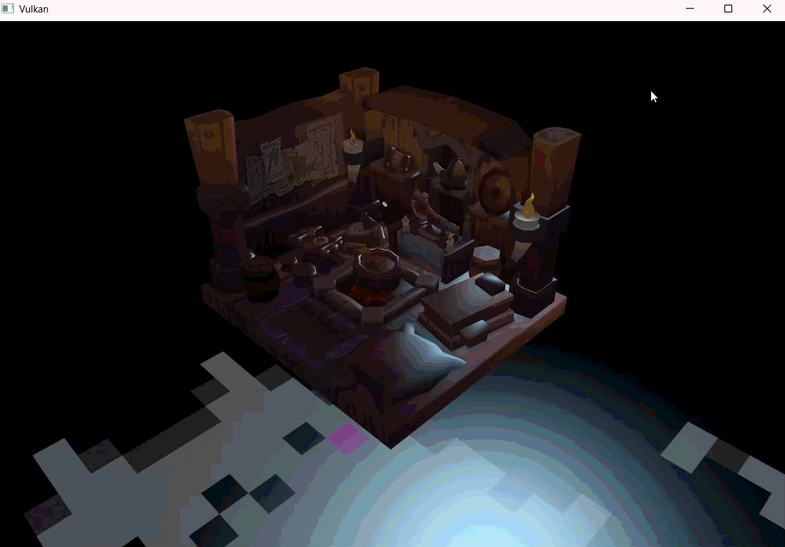

# rat-renderer


A real-time renderer built from scratch in **Vulkan 1.3** with C++20 and **Slang** shaders. It started from the Vulkan Tutorial and grew into a small engine with a GPU compute particle system, a mesh abstraction, and a debugging workflow built around RenderDoc.

<!-- Add a hero screenshot or GIF here -->



## Features

**Rendering**
- Vulkan 1.3 dynamic rendering and synchronization2 (no render pass or framebuffer objects)
- MSAA with resolve to the swapchain image
- Depth buffering
- Textured OBJ loading with vertex deduplication (hash map)
- Mipmap generation (blit chain with per-level layout transitions)
- Anisotropic filtering with a shared sampler

**Lighting**
- Directional, point, and spot lights, up to 20 per frame
- Energy-normalized Blinn-Phong shading (Lambertian diffuse divided by π, `(8 + n) / 8π` specular normalization)
- Distance attenuation for point and spot lights
- Spot lights with inner and outer cone angles and a smooth falloff between them
- Dear ImGui light editor: add and remove lights and edit their type, color, intensity, position, direction, and cone angles at runtime

**GPU particle system**
- Compute shader simulation with ping-pong SSBOs
- Compute-to-graphics synchronization with semaphores
- Particles rendered as points with additive blending and a shader-controlled point size
- ~100k particles

**Architecture**
- `PipelineConfig` abstraction for creating graphics, particle, and compute pipelines
- `Mesh` struct that owns its vertex/index buffers, texture, image view, and descriptor sets
- `createMesh`, `createPlane`, and `renderMesh` for building and drawing scene objects
- Push constants for the per-mesh model matrix
- Per-mesh descriptor sets (each mesh binds its own texture)
- Procedural plane with a default white texture, so untextured meshes use their vertex colors
- Slang shaders compiled to SPIR-V as part of the CMake build

## Building

**Requirements**
- Vulkan SDK 1.4.335 or newer (includes `slangc`)
- CMake 3.29+
- A C++20 compiler (developed with MSVC 2022 on Windows)
- Packages found through `find_package`: glfw3, glm, tinyobjloader, tinygltf, KTX, stb, Dear ImGui (with the GLFW and Vulkan bindings)

**Steps**
```
git clone https://github.com/elmerv/rat-renderer.git
cd rat-renderer
mkdir build && cd build
cmake ..
cmake --build .
```

**Running**
Run the executable from `build/VulkanTutorial/`. The build copies models and textures there and compiles the shaders into `shaders/`, and the program loads them by relative path.

## Architecture

### Pipelines
There are three pipelines, all created through `PipelineConfig` (shader module, entry points, layout, vertex input, topology, depth and blend settings):

| Pipeline | Purpose | Layout |
|---|---|---|
| `graphicsPipeline` | Draws meshes | UBO + texture sampler set, push constant for the model matrix |
| `particlePipeline` | Draws particles as points | UBO + SSBO set |
| `computePipeline` | Simulates particles | UBO + SSBO set |

### Particle simulation
Two storage buffers hold particle state. Each frame, the compute shader reads from one and writes to the other, and the particle draw then uses the freshly written buffer as its vertex buffer. The roles swap every frame (ping-pong), so no frame reads data that another is writing.

### Synchronization
- Compute submits first and signals a semaphore. The graphics submit waits on it at the vertex input stage.
- The graphics submit also waits for the acquired swapchain image at the color attachment output stage.
- Present semaphores are created per swapchain image rather than per frame in flight, to avoid reusing a semaphore the presentation engine may still hold.
- Fences track the compute and graphics work for each frame in flight.

### Meshes and descriptors
Each `Mesh` owns its GPU resources, and `renderMesh` binds the mesh's own descriptor set, pushes its transform, and issues the draw. The shared per-frame uniform buffer (view, projection, camera position, delta time, and the light array) is referenced from every mesh's descriptor set.

### Lighting
The scene keeps its lights in a `std::vector<Light>`, which the ImGui editor modifies directly. A `std::vector` can't be copied into a uniform buffer, because its elements live on the heap and only a pointer sits inside the vector. So each frame, `updateUniformBuffer` copies the active lights into a fixed-size array in the UBO and records how many there are:

```cpp
ubo.lightCount = static_cast<uint32_t>(std::min<size_t>(scene.lights.size(), MAX_LIGHTS));
std::copy_n(scene.lights.begin(), ubo.lightCount, ubo.lights);
```

The fragment shader loops over `lightCount` lights and adds up each one's contribution on top of a constant ambient term. A single `Light` struct covers all three types, and each type reads only the fields it needs:

| Type | Uses | Attenuation |
|---|---|---|
| Directional | direction | none (light arrives parallel, from infinitely far away) |
| Point | position | `1 / (1 + 0.09d + 0.032d²)` |
| Spot | position, direction, inner/outer cone | distance attenuation × `smoothstep(outerCone, innerCone, θ)` |

Cone angles are stored as cosines. The shader gets `cos θ` for free from a dot product of two unit vectors, so it can compare against the stored values without calling any trigonometric functions. The editor converts them to degrees for display.

### GPU struct layout
The C++ `Light` and `UniformBufferObject` structs have to match the Slang structs byte for byte, under std140 rules: a `vec3` must start on a 16-byte boundary, and every element of an array of structs starts on one too. C++ only aligns a `glm::vec3` to 4 bytes, so a mismatch compiles fine but silently shifts every field after it. Each `vec3` is paired with a `float` that fills the 4 bytes left at the end of its row, and explicit padding fills the remaining gaps:

```
Light (64 bytes)
offset  0 | position  (12) | innerCone (4) |
offset 16 | color     (12) | intensity (4) |
offset 32 | direction (12) | outerCone (4) |
offset 48 | type      (4)  | pad       (12)|

UniformBufferObject
offset   0 | model, view, proj (3 × mat4)
offset 192 | cameraPosition (12) | deltaTime (4) |
offset 208 | lightCount     (4)  | pad      (12) |
offset 224 | lights[20]  (20 × 64 bytes)
```

## Debugging with RenderDoc

I used RenderDoc to find GPU bugs that produced no crash or validation error, only wrong or missing output.

### Particles invisible: UBO missing from the vertex stage
**Symptom:** The particle pass drew nothing visible, even though the compute pass was updating particle data.

**Investigation:** I captured a frame and compared the pipeline state of the compute dispatch with the particle draw call. The compute stage showed the uniform buffer (Set 0, Binding 0) and both SSBOs bound correctly. The vertex stage of the particle draw showed no resources and no uniform buffers, even though both used the same descriptor set.

**Cause:** Binding 0 of the descriptor set layout only had `eCompute` in its stage flags. The particle vertex shader needs the UBO for the view and projection matrices, so the vertex stage could not see it.

**Fix:** Added `eVertex` to the binding's stage flags (`eCompute | eVertex`). The particles rendered immediately afterward.

### Per-mesh position ignored: push constants not reaching the vertex stage
**Symptom:** Changing a mesh's position had no effect, and the plane kept spinning like the old UBO-driven model matrix.

**Investigation:** In the Pipeline State view, the vertex stage showed no Push Constants section. That meant the shader had no push constant block, even though `vkCmdPushConstants` appeared in the event list with the correct 64 bytes.

**Cause:** I had edited the wrong shader file, so the compiled shader being loaded was still the old version.

**Fix:** Made the change in the correct shader file. The Pipeline State then showed the push constant block, and the position took effect.

### Techniques
- Comparing the Pipeline State of different stages (CS vs VS) to see which resources each could access
- Reading VS Output in the Mesh Viewer to check clip-space positions and `w`
- Inspecting uniform buffer contents and byte ranges against the C++ struct layout
- Using shader reflection (what the shader declares) to catch stale or wrong shader binaries

<!-- Add a cropped screenshot of the empty VS Resources panel next to the full CS panel -->

## Roadmap
- [x] Blinn-Phong lighting with directional, point, and spot lights
- [x] Dear ImGui light editor
- [ ] Shadow mapping (multi-pass rendering)
- [ ] PBR (Cook-Torrance BRDF)
- [ ] Dear ImGui controls for particle parameters
- [ ] Atmosphere rendering based on Hillaire's sky model

## References
- [Vulkan Tutorial](https://vulkan-tutorial.com)
- Hillaire, *A Scalable and Production Ready Sky and Atmosphere Rendering Technique* (planned)

PLEASE NOTE THIS README WAS BUILT WITH CLAUDE AS I'VE BEEN USING IT TO BUILD THIS RENDERER AND LEARN ABOUT VULKAN.
